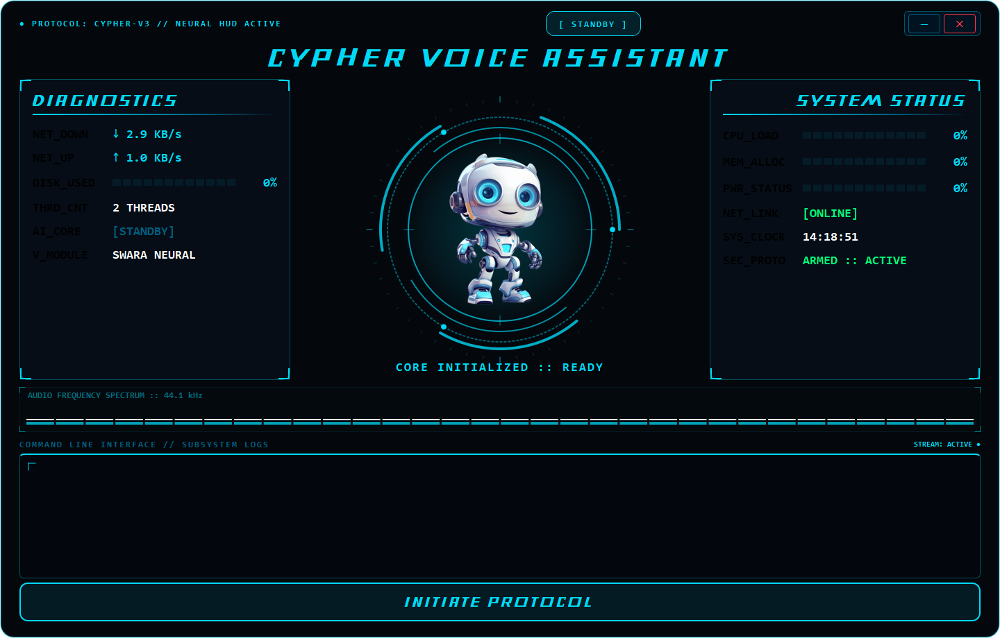
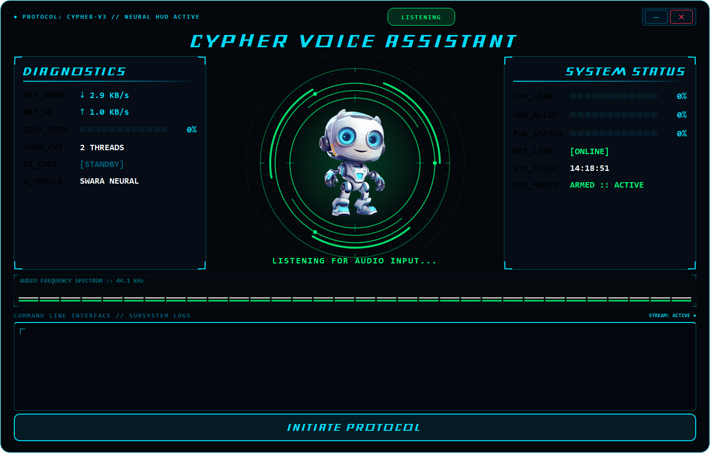
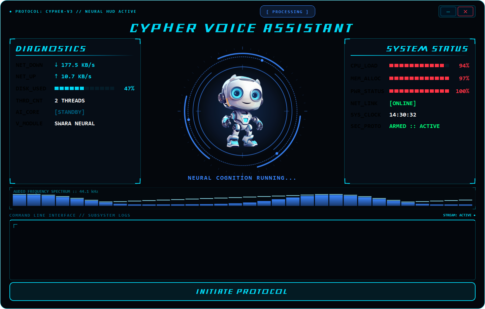
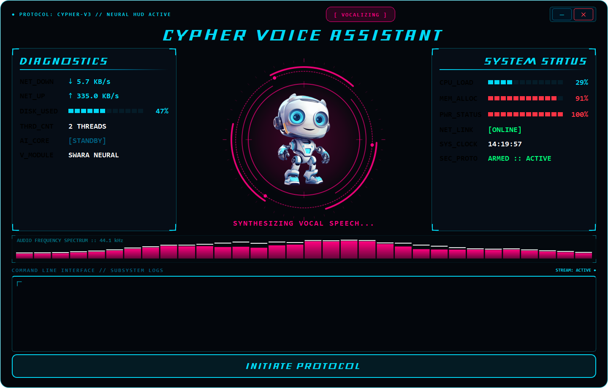
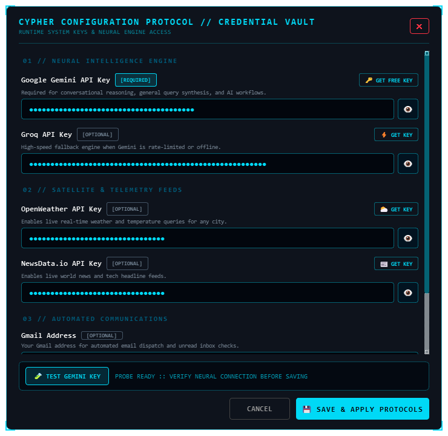
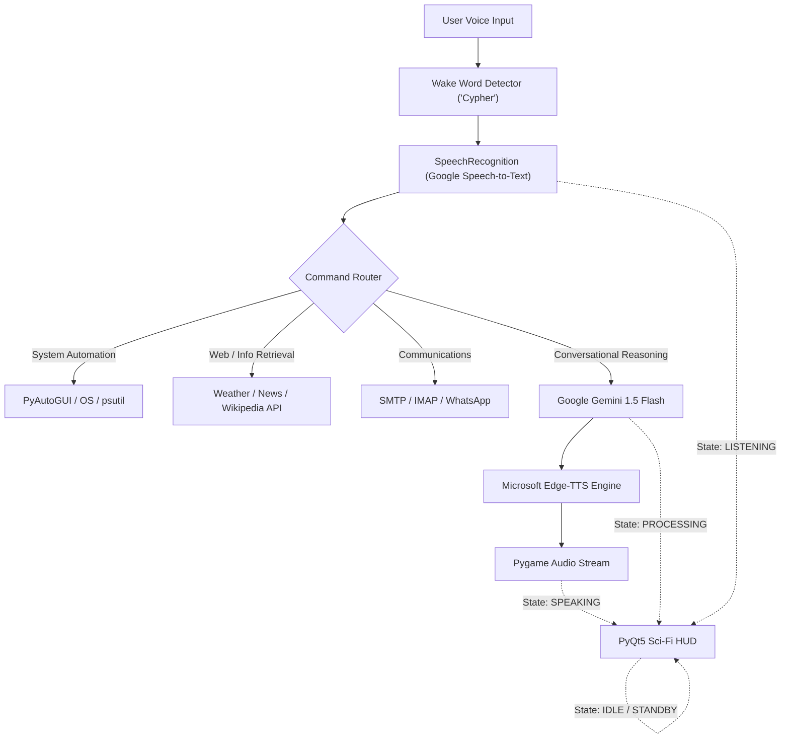

# 🧠 Cypher AI — Holographic F.R.I.D.A.Y. Desktop HUD & Autonomous Assistant

<div align="center">


<br/>

**A next-generation desktop AI assistant inspired by Tony Stark's F.R.I.D.A.Y., featuring a sci-fi HUD with an animated multi-ring Arc Reactor, real-time 32-band audio spectrum equalizer, segmented LED telemetry gauges, and Google Gemini 1.5 Flash intelligence.**

<br/>

[Key Features](#-key-features) • [HUD Showcase](#-hud-visual-gallery) • [Architecture](#-system-architecture) • [Installation](#-installation--quick-start) • [Voice Commands](#-command-matrix) • [Author](#-author--connect)

</div>

---

## 📸 HUD Visual Gallery

Cypher features an interactive, reactive sci-fi interface built on PyQt5 that dynamically responds to 4 distinct operational states:

| **STANDBY (IDLE)** | **LISTENING** |
| :---: | :---: |
|  |  |
| *Concentric Arc Reactor with 48-tick radar compass, counter-rotating orbital satellite beads, and targeting reticles.* | *Matrix-green frequency glow with expanding sonar ripple wave pulses radiating from the core.* |
| **PROCESSING** | **VOCALIZING** |
|  |  |
| *Electric-blue vortex hyperspeed rotation with accelerated energy arcs while Gemini synthesizes responses.* | *Harmonic vocal pulse, neon-magenta HUD shift, and active 32-band audio spectrum equalizer.* |

<br/>

<div align="center">

### ⚙️ Protocol Configuration & Credentials Vault


*Built-in Holographic Credentials Vault: Configure API keys, test live connections to Google AI Studio, and hot-reload settings with zero restart required.*

</div>

---

## ⚡ Key Features

### 🖥️ Holographic Sci-Fi HUD (PyQt5)
* **Multi-Ring Arc Reactor (`RotatingCore`):** Custom vector-rendered reactor with 48 radar tick marks, 3-segmented outer energy blades, an orbital ring with orbiting satellite beads, and central targeting crosshairs.
* **Contextual State Engine:** Transitions smoothly between `idle` (cyan/blue), `listening` (matrix-green with sonar waves), `processing` (electric-blue vortex), and `speaking` (neon-magenta with vocal pulses).
* **32-Band Audio Spectrum Equalizer (`VoiceVisualizer`):** Real-time audio frequency visualizer with harmonic sine dynamics and floating white peak caps that realistically decay.
* **12-Segment LED Telemetry Gauges (`SegmentedGauge`):** Hardware diagnostics for **CPU Load**, **Memory Allocation**, **Battery Status**, and **Disk Storage** with dynamic color warning shifts (Cyan ➔ Amber ➔ Red).
* **Cyberpunk Corner Reticles & Terminal:** Framed by HUD corner tech brackets `[ ┏ ┓ ┗ ┛ ]`, a real-time status pill, and a hacker-style terminal log with typewriter animation.
* **Standalone Credentials Vault (`SettingsDialog`):** Interactive settings modal accessible via `[⚙ CONFIG]` or auto-prompted on first run. End users of the standalone `.exe` can enter their API keys (Gemini, Groq, OpenWeather, NewsData, Email), probe live connections to Google AI Studio, and hot-reload credentials without ever touching code or manually creating a `.env` file.

### 🤖 Generative AI & Conversational Memory
* **Google Gemini 1.5 Flash:** High-speed conversational reasoning, code assistance, and witty personality.
* **Persistent Context:** Preserves dialogue history across wake cycles via local memory buffers (`chat_memory.json`).
* **Hands-Free Wake Word:** Listens continuously for **"Cypher"** before engaging active speech recognition.

### 🎙️ Neural Voice Interaction
* **Natural Neural Speech:** Powered by Microsoft `Edge-TTS` (Indian-English female neural voice) for expressive, human-like voice synthesis.
* **Low-Latency Streaming:** Plays synthesized speech directly via Pygame audio streams while keeping the GUI responsive.

### 🛠️ Autonomous System Automation
* **App Orchestration:** Launch apps (Chrome, VS Code, Notepad, Spotify, Calculator, Terminal, etc.) via voice.
* **Window & Tab Management:** Switch between active windows, switch browser tabs, close apps, or minimize to desktop.
* **Hardware Controls:** Adjust volume levels, screen brightness, and trigger system Sleep, Lock, Restart, or Shutdown sequences.
* **Voice Dictation Mode:** Dictates speech directly into any focused input field ("Type what I say...").

### 🌐 Live Web Intelligence & Communications
* **Real-Time Data:** Live weather reports (OpenWeatherMap API), world news headlines (NewsData API), and instant Wikipedia summaries.
* **Automated Email Client:** Voice-compose and send emails via SMTP; listen to unread incoming emails via IMAP.
* **WhatsApp Automation:** Instant WhatsApp message delivery to stored SQLite database contacts.
* **Network Telemetry:** Live ping and bandwidth speed diagnostics using `speedtest-cli`.

---

## 📂 System Architecture

```text
Cypher-AI/
├── gui.py              # Holographic PyQt5 HUD, Arc Reactor & Audio Visualizer
├── main.py             # Core Voice Pipeline, Gemini AI, & Command Router
├── requirements.txt    # Python dependencies
├── contact.db          # SQLite Database for Phone & Email Contacts
├── chat_memory.json    # Persistent multi-turn dialogue memory
├── .env                # API Keys & Secrets (Private)
├── font/               # Custom Sci-Fi & Monospace Fonts
└── screenshots/        # High-resolution HUD state captures
    ├── cypher_gui_idle.png
    ├── cypher_gui_listening.png
    ├── cypher_gui_processing.png
    └── cypher_gui_speaking.png
```



---

## 🚀 Installation & Quick Start

### 1. Clone the Repository

```bash
git clone https://github.com/pattanayakpratik/Cypher-AI.git
cd Cypher-AI
```

### 2. Create and Activate Virtual Environment

```bash
# Windows
python -m venv .venv
.\.venv\Scripts\activate
```

### 3. Install Dependencies

```bash
pip install -r requirements.txt
```

> [!NOTE]
> If you encounter audio driver issues with `PyAudio` on Windows, install the precompiled `.whl` wheel for your Python version or run `pip install pipwin && pipwin install pyaudio`.

### 4. Configure Environment Variables

Create a `.env` file in the root directory:

```ini
# Google Gemini AI Key (Get from https://aistudio.google.com/)
GEMINI_API_KEY=your_gemini_api_key_here

# Weather & News APIs
OPENWEATHER_KEY=your_openweather_api_key
NEWS_API_KEY=your_newsdata_api_key

# Email Credentials (Optional: use Google App Password)
EMAIL_USER=your_email@gmail.com
EMAIL_PASS=your_google_app_password
```

### 5. Launch Cypher

Start the holographic interface (which automatically initializes the voice engine):

```bash
python gui.py
```

---

## 🎮 Command Matrix

| Category | Example Voice Trigger | Action Performed |
| :--- | :--- | :--- |
| **System** | *"Open Chrome"* / *"Open VS Code"* | Launches target application executable |
| **Navigation** | *"Switch tab"* / *"Close window"* | Sends keyboard shortcuts via PyAutoGUI |
| **Hardware** | *"Increase volume"* / *"Set brightness to 80"* | Modifies Windows hardware audio & display levels |
| **AI Intelligence** | *"Explain quantum computing in simple terms"* | Synthesizes response with Gemini 1.5 Flash |
| **Real-Time Data** | *"What's the weather in Mumbai?"* | Fetches temperature, humidity & conditions |
| **News** | *"Give me the latest tech headlines"* | Reads top 3 articles from NewsData API |
| **Research** | *"Search Wikipedia for Artificial Intelligence"* | Summarizes first 2 sentences from Wikipedia |
| **Communication** | *"Send an email to John"* | Hands-free email composition and dispatch |
| **Dictation** | *"Type what I say: Meeting postponed to 5 PM"* | Types dictated text into active window cursor |
| **Power** | *"Turn off"* / *"Shutdown system"* | Closes Cypher and shuts down Windows |

---

## 🛡️ Roadmap

- [x] Multi-ring animated Arc Reactor with radar calibration & orbital beads
- [x] 32-band real-time audio spectrum frequency visualizer
- [x] 12-segment illuminated LED telemetry meters for system diagnostics
- [x] Native 4-state visual sync (Idle, Listening, Processing, Speaking)
- [ ] Multimodal Screen Vision via Gemini 1.5 Pro / Flash Vision
- [ ] Offline wake-word detection via Picovoice Porcupine
- [ ] Direct Spotify IPC playback integration
- [ ] Customizable HUD color themes (Stark Crimson & Gold, Cyberpunk Neon, Matrix Green)

---

## 👨‍💻 Author & Connect

**Pratik Pattanayak**  
*Backend & AI Engineer | AWS Certified ML Practitioner*

- 🌐 **Portfolio:** [pattanayakpratik.vercel.app](https://pattanayakpratik.vercel.app)
- 🐙 **GitHub:** [@pattanayakpratik](https://github.com/pattanayakpratik)
- 💼 **LinkedIn:** [Pratik Pattanayak](https://www.linkedin.com/in/pattanayakpratik)
- 📧 **Email:** [mr.pratikpattanayak@gmail.com](mailto:mr.pratikpattanayak@gmail.com)

---

<div align="center">
  <sub>Engineered with 💙 using Python, PyQt5, and Google Gemini. Star ⭐ the repository if you found this project inspiring!</sub>
</div>
